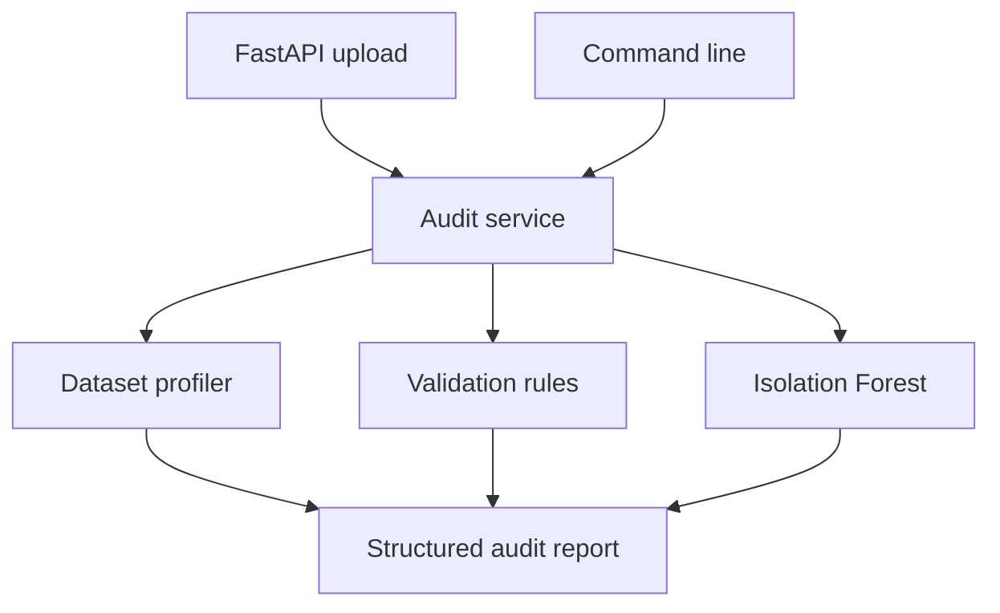

<div align="center">


### Know your data before you trust it.

A local CSV auditing backend that combines deterministic validation with machine learning to surface data quality issues and unusual records.


[Overview](#overview) · [Quick Start](#quick-start) · [API](#api) · [Rules](#validation-rules) · [Development](#development)

</div>

---

## Overview

**ALZA AI Lab** turns a CSV dataset into a structured audit report. It profiles the data, checks configured constraints, and uses **Isolation Forest** to flag statistically unusual rows for review.

Use it through a **FastAPI REST API** or directly from the **command line**. The current implementation runs its analysis locally, without an external AI API key.

> **Current release: v0.3.0.** CSV auditing is implemented. The assistant files are placeholders; a conversational assistant and frontend are not implemented.

## What It Does

| Capability | What you get |
| --- | --- |
| Dataset profiling | Row and column counts, duplicate row count, inferred types, missing percentages, and unique value counts |
| Quality validation | Missing-value findings, configured numeric bounds, and allowed category checks |
| Reusable rule engine | Python-level rules for required columns, expected types, uniqueness, severity, and ML feature selection |
| Anomaly detection | Numeric-row analysis with Isolation Forest, anomaly scores, and row references |
| Structured reporting | A Pydantic response contract with separate quality issues and ML findings |
| CSV upload endpoint | Filename checks, empty-file rejection, a 10 MiB limit, and temporary-file cleanup |
| Command-line auditing | A readable terminal report using the same audit service |

## Architecture



The API and CLI share `audit_csv()` in `app/auditor/service.py`. pandas reads and profiles the CSV, the rule engine produces deterministic findings, and scikit-learn evaluates eligible numeric columns.

## Quick Start

### 1. Clone the repository

```bash
git clone https://github.com/azinamouto/alza-ai-lab.git
cd alza-ai-lab
```

### 2. Create a virtual environment

The repository contains Python 3.14 bytecode artifacts, but does not declare a supported Python version range. Python 3.14 is a reasonable starting point; dependency compatibility is determined by the pinned `requirements.txt`.

**Windows PowerShell**

```powershell
py -3.14 -m venv .venv
.\.venv\Scripts\Activate.ps1
python -m pip install -r requirements.txt
```

**macOS / Linux**

```bash
python3.14 -m venv .venv
source .venv/bin/activate
python -m pip install -r requirements.txt
```

### 3. Start the API

```bash
python -m uvicorn app.main:app --reload --host 127.0.0.1 --port 8000
```

| Local URL | Purpose |
| --- | --- |
| http://127.0.0.1:8000/docs | Interactive Swagger API documentation |
| http://127.0.0.1:8000/redoc | ReDoc API documentation |
| http://127.0.0.1:8000/health | Service health and version |

No environment variables are currently required by the implemented auditor. `.env.example` and `app/core/config.py` are empty placeholders.

### 4. Audit your first dataset

Open `/docs`, expand **POST /api/v1/audit**, select **Try it out**, and upload `data/sample/test_bad_data.csv`.

Or run the CLI from the repository root:

```bash
python -m app.audit data/sample/test_bad_data.csv
```

## API

| Method | Route | Description |
| --- | --- | --- |
| `GET` | `/health` | Returns service status, name, and version |
| `POST` | `/api/v1/audit` | Accepts one CSV in the multipart `file` field and returns an audit report |

### Upload a CSV

**Windows PowerShell**

```powershell
curl.exe -X POST "http://127.0.0.1:8000/api/v1/audit" -F "file=@data/sample/test_bad_data.csv"
```

**macOS / Linux**

```bash
curl -X POST "http://127.0.0.1:8000/api/v1/audit" \
  -F "file=@data/sample/test_bad_data.csv"
```

### Report structure

| Field | Contents |
| --- | --- |
| `dataset` | Uploaded filename |
| `profile` | Dataset dimensions, duplicate rows, and column profiles |
| `summary` | Total issues, errors, warnings, ML anomaly count, and final status |
| `issues` | Deterministic validation findings |
| `ml_analysis` | Model name, anomaly count, and scored anomaly findings |

The existing API regression test expects this summary for `test_bad_data.csv`:

```json
{
  "total_issues": 5,
  "errors": 3,
  "warnings": 2,
  "ml_anomalies": 1,
  "status": "REVIEW_REQUIRED"
}
```

`summary.warnings` includes ML anomalies. `total_issues` counts both rule findings and ML findings. Row references are zero-based pandas indices, not physical CSV line numbers.

### Audit statuses

| Status | Meaning |
| --- | --- |
| `PASS` | No rule errors, rule warnings, or ML anomalies |
| `WARNING` | At least one warning or ML anomaly, with no rule errors |
| `REVIEW_REQUIRED` | At least one rule error |

### Request errors

| HTTP status | Trigger |
| --- | --- |
| `400` | Missing filename, non-CSV filename, empty upload, unreadable empty CSV, or parser error |
| `413` | Uploaded content exceeds 10 MiB (`10 × 1024 × 1024` bytes) |
| `422` | Required multipart `file` field is missing |
| `500` | Unexpected audit failure |

## Validation Rules

The API and CLI currently use `DEFAULT_RULES` in `app/auditor/service.py`:

| Column | Default check |
| --- | --- |
| `age` | Value must be between 0 and 120, inclusive |
| `income` | Value must be at least 0 |
| `gender` | Non-null values must be `M` or `F` |
| Any column | Missing values generate findings |

These default named columns are optional. Numeric range checks run only on columns pandas recognizes as numeric. Duplicate rows are counted in the profile; they do not independently create a validation issue.

### Use custom rules in Python

```python
import pandas as pd

from app.auditor.anomaly import detect_anomalies
from app.auditor.quality import validate_columns
from app.core.schemas import ColumnRule

df = pd.read_csv("households.csv")

rules = [
    ColumnRule(
        column="household_id",
        required=True,
        unique=True,
        include_in_ml=False,
    ),
    ColumnRule(
        column="members",
        expected_dtype="int",
        minimum=1,
        maximum=30,
        severity="ERROR",
    ),
]

issues = validate_columns(df, rules)
anomalies = detect_anomalies(df, rules=rules)
```

The upload endpoint does **not** currently accept custom rules. To change full API/CLI audits, edit `DEFAULT_RULES`; to use rules programmatically, call the validation and anomaly functions directly.

Missing values are still reported when `nullable=True`. Missing-value and missing-required-column findings default to warnings; expected-type mismatches are errors and uniqueness findings are warnings. Severity overrides apply to missing-value, required-column, numeric-range, and category checks.

## How ML Analysis Works

- Numeric columns are eligible by default. Set `include_in_ml=False` to exclude identifiers or other unsuitable numeric fields.
- `include_in_ml=True` retains an eligible numeric column; it does not exclude other numeric columns or encode text values.
- Missing numeric values are filled with column medians. Columns that remain entirely null are removed.
- Isolation Forest runs with `contamination=0.1` and `random_state=42` by default.
- If no usable numeric features remain, the anomaly detector returns an empty list.

An anomaly means a row is statistically unusual. It is a review signal, not proof of incorrect data. A dataset named “clean” can still receive ML warnings.

## Project Structure

| Path | Responsibility |
| --- | --- |
| `app/main.py` | FastAPI application, health route, and auditor router registration |
| `app/api/auditor.py` | CSV upload validation and response handling |
| `app/audit.py` | Command-line entry point and terminal report |
| `app/auditor/service.py` | Shared audit orchestration and default rules |
| `app/auditor/profiler.py` | Dataset and column profiling |
| `app/auditor/quality.py` | Deterministic validation functions |
| `app/auditor/anomaly.py` | ML feature selection and Isolation Forest |
| `app/core/schemas.py` | Pydantic rule and report models |
| `app/api/assistant.py`, `app/assistant/` | Assistant placeholders |
| `data/sample/` | Bad, clean, header-only, and malformed sample CSV files |
| `tests/` | API, profiling, validation, and anomaly tests |
| `requirements.txt` | Pinned Python dependencies |

## Development

Run the existing test suite from the repository root:

```bash
python -m pytest -q
```

The suite covers upload rejection, health responses, audit response contracts, sample-data regression checks, duplicate-row profiling, configurable rules, and ML feature selection. Test results depend on your installed environment; this README does not claim a verified passing run.

### Current boundaries

The project currently provides a CSV API and CLI. Authentication, a frontend, persisted audit history, export endpoints, and conversational assistant behavior are not implemented. The API reads the entire upload before checking its size and runs the audit within the request.

### Suggested Next Steps

These are proposed improvements, not shipped features or release commitments:

- [ ] Accept validated custom rules through the API.
- [ ] Add a frontend for uploads and audit review.
- [ ] Export audit reports and retain audit history.
- [ ] Move larger audits into background jobs.
- [ ] Implement the assistant module.
- [ ] Add CI and declare supported Python versions.
- [ ] Populate `.gitignore` and remove tracked Python bytecode.

## Contributing

Keep API changes aligned with the Pydantic report contract. Add regression coverage for validation changes, run the test suite, and describe any behavior changes in your pull request.

## License

No license file is currently included in the repository. Reuse and distribution terms have not been explicitly defined.

---

<div align="center">

**ALZA AI LAB**

Profile. Validate. Detect.

[Repository](https://github.com/azinamouto/alza-ai-lab) · [Report an Issue](https://github.com/azinamouto/alza-ai-lab/issues)

</div>
